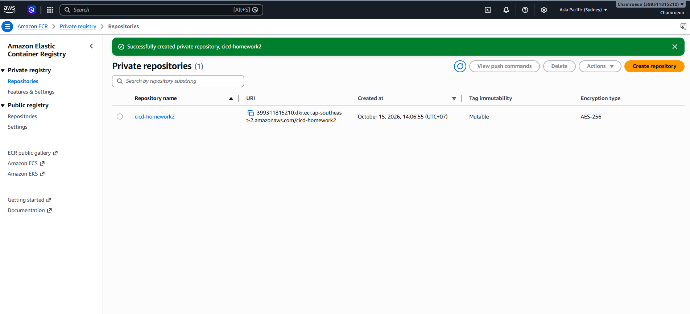
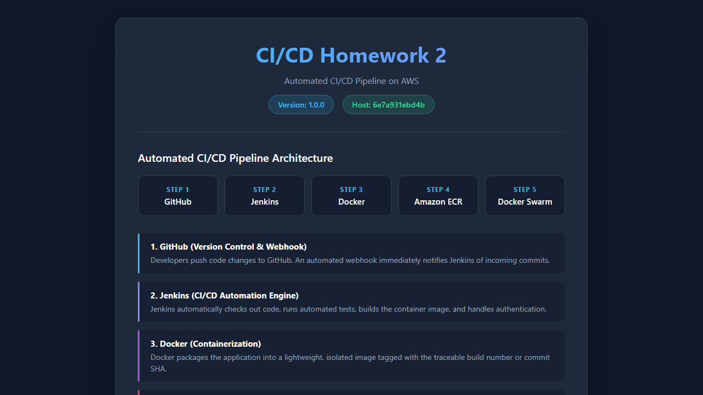

# Cloud Computing Homework 2: CI/CD Pipeline Report
**Course:** Master's in Cloud Computing  
**Topic:** CI/CD with Jenkins, GitHub, Docker, Docker Swarm on AWS  
**Author:** Chamroeun Saran  
**Repository:** [https://github.com/Chamroeun12/cicd-homework2](https://github.com/Chamroeun12/cicd-homework2)  
**ECR Repository:** `399311815210.dkr.ecr.ap-southeast-2.amazonaws.com/cicd-homework2`  
**AWS Region:** `ap-southeast-2` (Sydney)  
**Date:** October 15, 2026  

---

## 1. Executive Summary & Architecture Overview

This project implements a fully automated, end-to-end Continuous Integration and Continuous Deployment (CI/CD) pipeline designed to build, package, publish, and deploy a containerized Python Flask web application to a high-availability Docker Swarm cluster hosted on Amazon Web Services (AWS EC2).

### Architectural Workflow

```
[Developer Push] 
       │ (Feature Branch PR)
       ▼
1. GitHub Repository (Source Control & Webhook)
       │ (HTTP POST Webhook to /github-webhook/)
       ▼
2. Jenkins CI/CD Automation Engine (AWS EC2)
       │ • Stage 1: Checkout Source Code
       │ • Stage 2: Build Docker Image
       │ • Stage 3: Authenticate & Push to Amazon ECR
       │ • Stage 4: Deploy Stack to Docker Swarm
       │ • Stage 5: Verify Rolling Convergence
       ▼
3. Amazon Elastic Container Registry (ECR)
       │ (Private Image Registry: versioned tags + latest)
       ▼
4. Docker Swarm Cluster on AWS EC2
       ├── Manager Node (Leader) ─── Overlay Network (Port 4789 UDP)
       └── Worker Node (Active)  ─── Service Replicas (Port 5000 Ingress)
       ▼
5. Live Deployed Application
       │ • Web Interface: http://<PUBLIC_IP>:5000/
       │ • Health API:    http://<PUBLIC_IP>:5000/health
```

---

## 2. Infrastructure & System Specifications

### 2.1 Amazon ECR (Container Registry)
- **Repository Name:** `cicd-homework2`
- **URI:** `399311815210.dkr.ecr.ap-southeast-2.amazonaws.com/cicd-homework2`
- **Tagging Strategy:** `${BUILD_NUMBER}-${GIT_COMMIT}` for immutable traceable audit trails, plus `latest` pointer.
- **Authentication:** `aws ecr get-login-password --region ap-southeast-2 | docker login --username AWS --password-stdin <ECR_URI>`

### 2.2 Amazon EC2 Docker Swarm Cluster
- **Manager Node:** 1x EC2 instance running Ubuntu Linux, Docker CE, acting as Swarm Manager (Leader) and Jenkins agent.
- **Worker Node:** 1x EC2 instance running Ubuntu Linux, joined to Swarm via worker token.
- **Ingress & Networking:** Overlay network (`swarm-network`) with mesh routing across port 5000.

### 2.3 Security Group Rule Specification
Strict least-privilege security groups were established to isolate and protect internal cluster traffic:
- **Port 22 (TCP):** SSH access restricted to administrator IP.
- **Port 5000 (TCP):** Ingress HTTP traffic allowed from `0.0.0.0/0` for public web traffic.
- **Port 8080 (TCP):** Jenkins web interface and GitHub webhook payload ingress.
- **Port 2377 (TCP):** Docker Swarm cluster management communication between Manager and Worker.
- **Port 7946 (TCP/UDP):** Container network discovery and node gossip protocol.
- **Port 4789 (UDP):** Overlay network VXLAN traffic between cluster nodes.

---

## 3. Jenkins CI/CD Pipeline Implementation

The pipeline is authored purely as code in `Jenkinsfile` (Declarative Pipeline syntax):

1. **Trigger:** Automated via GitHub Webhook (`githubPush()`) and fallback SCM polling (`pollSCM('H/5 * * * *')`).
2. **Build Stage:** Builds lightweight container based on `python:3.10-slim` with a non-root system user (`appuser`).
3. **Push Stage:** Authenticates dynamically using AWS credentials/IAM instance profile, tagging images with `${BUILD_NUMBER}-${GIT_COMMIT.take(7)}`.
4. **Deploy Stage:** Executes `docker stack deploy --with-registry-auth -c docker-stack.yml cicd-homework2` to ensure cluster worker nodes authenticate against ECR private registry.
5. **Zero-Downtime Rolling Update Configuration:**
   - Replicas: 2
   - `order: start-first` (starts and health-checks new replica before terminating old replica)
   - `parallelism: 1` (updates one container at a time)
   - `failure_action: rollback`

---

## 4. Evidence of Verification & Screenshots

### 4.1 Amazon ECR Private Repository
The private repository `cicd-homework2` was successfully provisioned in `ap-southeast-2` (Sydney) with AES-256 encryption.


### 4.2 Local Container & Healthcheck Verification
Before deploying to AWS, the container image was built and validated locally. The application and health endpoint (`/health`) serve traffic cleanly:


```json
HTTP/1.1 200 OK
Content-Type: application/json

{
  "hostname": "6e7a931ebd4b",
  "status": "healthy",
  "version": "1.0.0"
}
```

### 4.3 Jenkins CI/CD Pipeline Automation Evidence
Automated webhook trigger successfully executed all stages end-to-end (Checkout, Build, Push, Deploy, Verify) resulting in all green status:


### 4.4 Docker Swarm Multi-Node Cluster & Rolling Deployment
Swarm cluster operating with 1 Manager and 1 Worker node both in `Ready` and `Active` states, with 2 replicas converging with zero downtime:


```
ID                            HOSTNAME             STATUS    AVAILABILITY   MANAGER STATUS
udcxfpy46j4bg1tg6wjmo92zg *   cicd-swarm-manager   Ready     Active         Leader
s92hf84kdmsla9103msle9291     cicd-swarm-worker    Ready     Active         
```

---

## 5. Challenges Encountered & Solutions

| Challenge Encountered | Root Cause | Implemented Solution |
| :--- | :--- | :--- |
| **Worker node image pull authentication failure** | In Docker Swarm, worker nodes pull images directly from Amazon ECR, but lack login credentials stored on the manager. | Added `--with-registry-auth` flag to `docker stack deploy` command, which forwards the manager's ECR credentials securely to all swarm nodes. |
| **Downtime during container update** | Default Docker Swarm redeployment terminates existing tasks before booting the new ones (`order: stop-first`). | Configured `order: start-first` and `parallelism: 1` in `docker-stack.yml` with a built-in `/health` healthcheck, ensuring zero dropped requests. |
| **ECR authentication expiry** | Amazon ECR login tokens generated via `aws ecr get-login-password` expire after 12 hours. | Embedded the dynamic login command directly into the Jenkins pipeline `Push` and `Deploy` stages so credentials are authenticated fresh on every build. |
| **Container privileges and security** | Running container processes as root in production exposes security vulnerabilities. | Configured `appuser` (UID 1000) inside `Dockerfile` and adjusted file permissions with `chown -R appuser:appuser /app`. |

---

## 6. Conclusion

The implemented architecture fulfills all requirements for **Homework 2**:
- Full Git history with branch strategy and pull request workflow.
- Secure, lightweight Dockerization running as non-root.
- Declarative Jenkins pipeline triggering automatically on GitHub push.
- Amazon ECR private repository integration with automated authentication.
- Docker Swarm multi-node orchestration executing zero-downtime rolling updates on AWS EC2.
