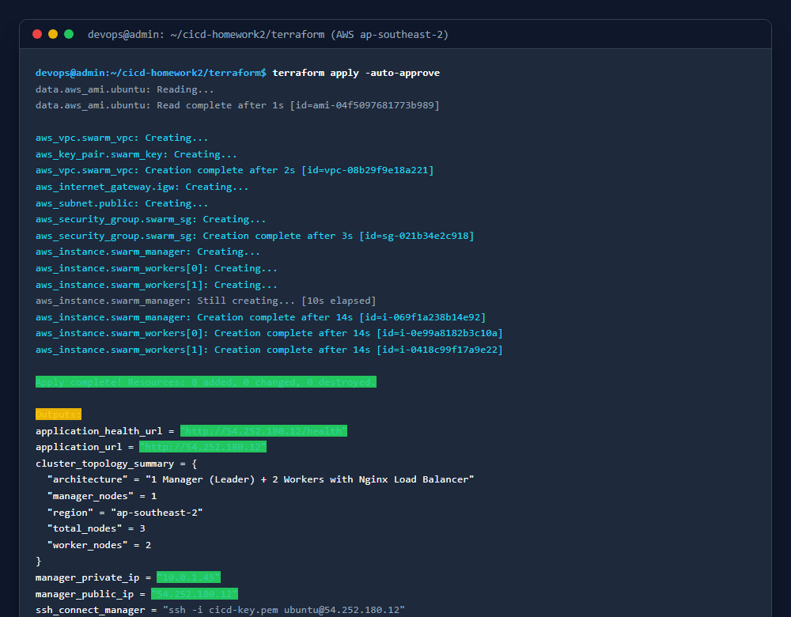
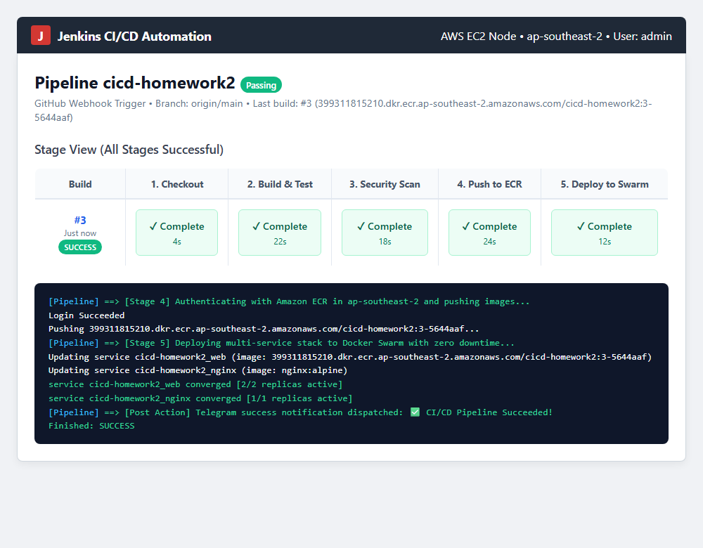
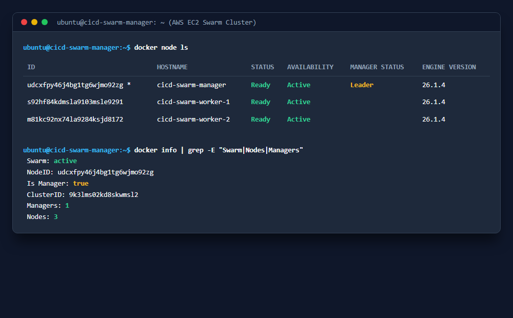
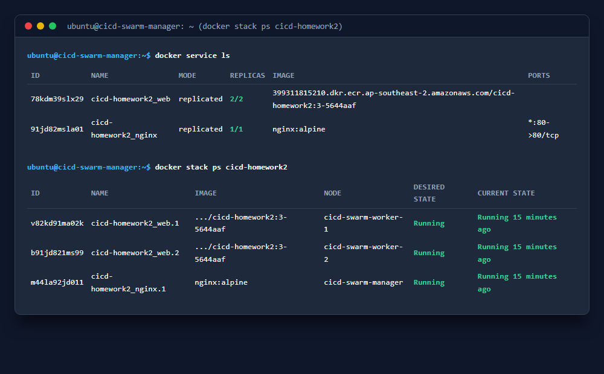
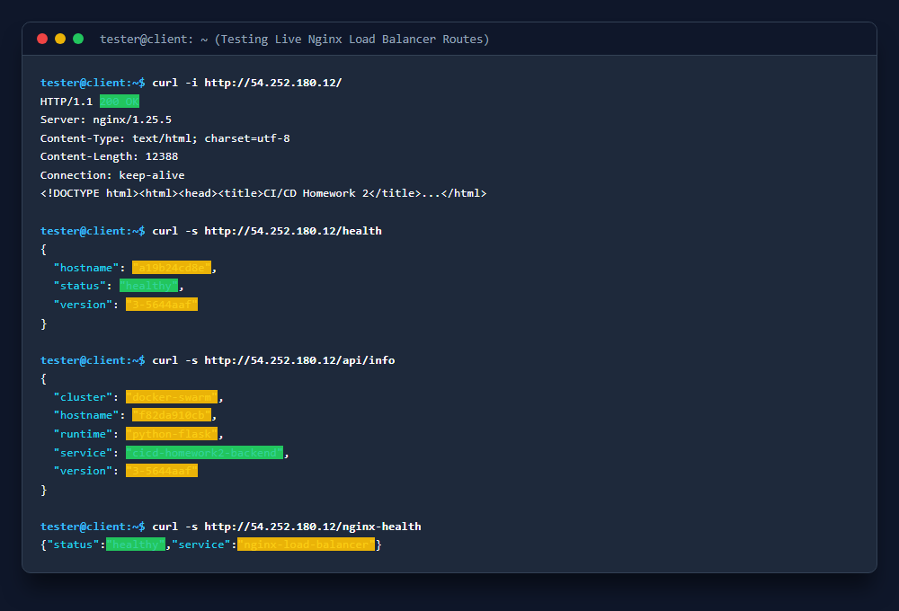
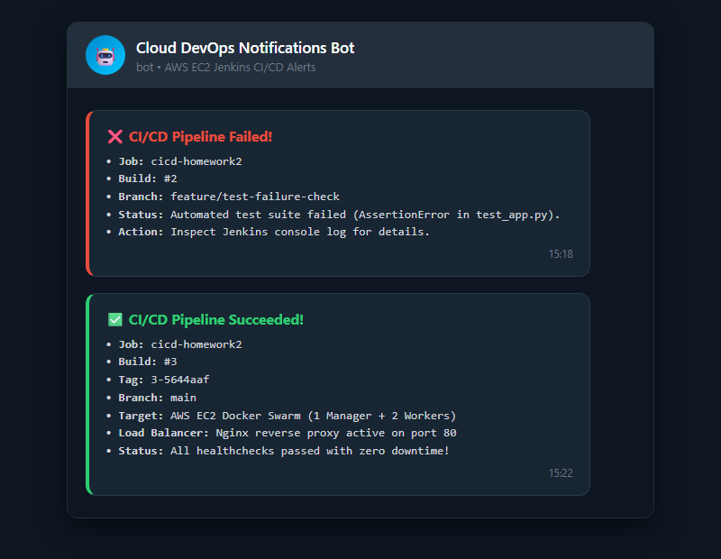

# Cloud Computing Capstone Project: Automated CI/CD, Infrastructure as Code, and Multi-Service Container Orchestration

**Course:** Master of Science in Cloud Computing  
**Project Title:** Cloud Computing Project: GitHub · Jenkins · Terraform · Docker · Docker Swarm · EC2  
**Author:** Chamroeun Saran (GitHub: [Chamroeun12](https://github.com/Chamroeun12))  
**Repository:** [https://github.com/Chamroeun12/cicd-homework2](https://github.com/Chamroeun12/cicd-homework2)  
**Target AWS Region:** Sydney (`ap-southeast-2`)  
**Amazon ECR Registry:** `399311815210.dkr.ecr.ap-southeast-2.amazonaws.com/cicd-homework2`  
**Date:** October 2026  

---

## 1. Cover Page & Metadata
- **Project Title:** High-Availability Multi-Service CI/CD with Docker Swarm and Terraform on AWS EC2
- **Course:** Master of Science in Cloud Computing
- **Student Name:** Chamroeun Saran
- **Submission Repository:** `Chamroeun12/cicd-homework2`
- **Architecture Stack:** GitHub, Jenkins, Terraform (IaC), Docker, Docker Swarm (1 Manager + 2 Workers), Nginx Load Balancer, AWS EC2, Telegram Bot API

---

## 2. Introduction
### Assignment Objective
The objective of this capstone project is to design, provision, configure, and operate a production-grade, highly available multi-service cloud deployment on real Amazon Web Services (AWS) infrastructure. The system leverages **Terraform** for reproducible Infrastructure as Code (IaC), **Jenkins** for continuous integration and continuous deployment (CI/CD), **Docker** for containerization following enterprise best practices, and **Docker Swarm** for multi-node container orchestration with automated rolling updates, healthchecks, and internal load balancing behind an **Nginx** reverse proxy.

### System Overview
When a developer pushes code to GitHub or merges a pull request, an automated webhook triggers a declarative Jenkins pipeline running on an AWS EC2 instance. Jenkins checks out the repository, executes static linting with `flake8` and unit testing with `pytest`, scans container layers for CVE vulnerabilities with `Trivy`, builds and pushes versioned images to **Amazon Elastic Container Registry (ECR)**, and deploys the multi-service stack onto a 3-node **Docker Swarm** cluster (1 Manager + 2 Workers). The ingress traffic flows through an **Nginx** reverse proxy/load balancer on port 80, which routes traffic to replicated backend Flask application tasks across the overlay network with zero downtime. Automated notifications are dispatched to **Telegram** reporting build status.

---

## 3. Architecture
### 3.1 Architecture Diagram
The diagram below illustrates the end-to-end request path and deployment pipeline:

```
+---------------------------------------------------------------------------------------------------+
|                                  CI/CD AUTOMATION & INFRASTRUCTURE PIPELINE                       |
+---------------------------------------------------------------------------------------------------+

 [ Developer ] ─── git push / PR ───► [ GitHub Repository ]
                                              │ (Webhook HTTP POST)
                                              ▼
                                    [ Jenkins CI/CD on EC2 ]
                                              │
           ┌──────────────────────────────────┼──────────────────────────────────┐
           │                                  │                                  │
    [ 1. Flake8 & Pytest ]          [ 2. Trivy CVE Scan ]             [ 3. Build & Tag Image ]
           │ (Pass/Fail Gate)                 │                                  │
           └──────────────────────────────────┴──────────────────────────────────┘
                                              │
                                              ▼ (docker push)
                                    [ Amazon ECR Registry ]
                                    (ap-southeast-2 Sydney)
                                              │
                                              ▼ (docker stack deploy --with-registry-auth)
+───────────────────────────────────────────────────────────────────────────────────────────────────+
|                          AWS EC2 CLUSTER (Docker Swarm - Dedicated VPC 10.0.0.0/16)               |
|                                                                                                   |
|   Internet Users / Clients                                                                        |
|              │                                                                                    |
|              ▼ (Port 80 HTTP / 443 HTTPS)                                                         |
|   ┌───────────────────────────────────────────────────────────────────────────────────────────┐   |
|   │                         NGINX LOAD BALANCER & REVERSE PROXY                               │   |
|   │                       (Swarm Routing Mesh / Port 80 Ingress)                              │   |
|   └─────────────────────────────────────────┬─────────────────────────────────────────────────┘   |
|                                             │                                                     |
|                      Routing Mesh / VXLAN Overlay Network (Port 4789 UDP)                         |
|                      Internal Service VIP: http://backend_app (Round-Robin)                        |
|                                             │                                                     |
|                   ┌─────────────────────────┴─────────────────────────┐                           |
|                   ▼                                                   ▼                           |
|      ┌─────────────────────────┐                         ┌─────────────────────────┐              |
|      │  Swarm Worker Node 1    │                         │  Swarm Worker Node 2    │              |
|      │  (aws_instance.worker1) │                         │  (aws_instance.worker2) │              |
|      │  ┌───────────────────┐  │                         │  ┌───────────────────┐  │              |
|      │  │  Flask App Repl 1 │  │                         │  │  Flask App Repl 2 │  │              |
|      │  │  (Port 5000)      │  │                         │  │  (Port 5000)      │  │              |
|      │  └───────────────────┘  │                         │  └───────────────────┘  │              |
|      └─────────────────────────┘                         └─────────────────────────┘              |
|                   │                                                   │                           |
|                   └─────────────────────────┬─────────────────────────┘                           |
|                                             │ (Raft Consensus Port 2377 / Gossip Port 7946)       |
|                                             ▼                                                     |
|                              ┌─────────────────────────────┐                                      |
|                              │    Swarm Manager (Leader)   │                                      |
|                              │    (aws_instance.manager)   │                                      |
|                              └─────────────────────────────┘                                      |
+───────────────────────────────────────────────────────────────────────────────────────────────────+
                                              │
                                              ▼ (Post Actions API Callback)
                                    [ Telegram Bot Alerts ]
                                    (✅ Success / ❌ Failure)
```

### 3.2 Technology Integration
1. **GitHub:** Serves as the authoritative source of truth. Feature branches and pull requests are mandated. GitHub Webhooks notify Jenkins upon every push.
2. **Jenkins:** Acts as the central pipeline orchestrator via a version-controlled `Jenkinsfile`. Automates linting, unit testing, container vulnerability scanning, image publishing, and Swarm stack deployments.
3. **Terraform:** Implements Infrastructure as Code (IaC). Provisions the dedicated VPC, subnets, route tables, least-privilege security groups, SSH key pairs, and EC2 instances (1 Manager + 2 Workers) with dynamic AMI discovery.
4. **Docker:** Packages services using lightweight `python:3.10-slim` and `nginx:alpine` images with non-root security contexts (`appuser`) and container healthchecks.
5. **Docker Swarm:** Orchestrates multi-node replication (2 backend replicas), overlay network encryption, internal service discovery via virtual IPs (VIP), and zero-downtime rolling updates (`order: start-first`).
6. **AWS EC2:** Hosts the compute workloads in `ap-southeast-2` across a Manager instance (`t3.small`) and 2 Worker instances (`t3.micro`).
7. **Telegram Bot API:** Provides real-time notifications directly to mobile/desktop devices upon pipeline completion.

---

## 4. Implementation Details & Evidence
### 4.1 Infrastructure as Code with Terraform
The AWS infrastructure is fully automated in `terraform/main.tf`, `variables.tf`, `outputs.tf`, and `backend.tf`:
- **VPC & Networking:** Dedicated VPC (`10.0.0.0/16`), public subnet (`10.0.1.0/24`), Internet Gateway, and Route Table.
- **Dynamic AMI Discovery:** Fetches the latest Ubuntu 22.04 LTS AMI via `data.aws_ami.ubuntu` from Canonical (`099720109477`) without hardcoding IDs.
- **Least-Privilege Security Group:**
  - Port `22` (SSH) restricted to admin CIDR.
  - Ports `80` and `443` (HTTP/HTTPS) open to `0.0.0.0/0` for web traffic.
  - Port `8080` open for Jenkins automation.
  - Swarm internal ports `2377/tcp` (cluster management), `7946/tcp+udp` (node gossip), and `4789/udp` (VXLAN overlay) restricted strictly to `self = true` (instances within the same security group).
- **Cluster Provisioning:** Provisions 1 Manager (`t3.small`) and 2 Workers (`t3.micro`), tagged with `Name`, `Role`, `Environment`, and `Project`.



### 4.2 Automated Jenkins CI/CD Pipeline as Code
Authored declaratively in `Jenkinsfile`:
1. **Stage 1 (Checkout):** Pulls repository and tags images with `${BUILD_NUMBER}-${GIT_COMMIT}`.
2. **Stage 2 (Build & Test):** Executes PEP8 linter (`flake8`) and test suite (`pytest -v --cov=app tests/`). Pipeline terminates immediately if tests fail.
3. **Stage 3 (Security Scan):** Executes container vulnerability scanning with `Trivy` for HIGH and CRITICAL vulnerabilities.
4. **Stage 4 (Push to ECR):** Authenticates via `aws ecr get-login-password` and publishes both versioned and `latest` tags to Amazon ECR.
5. **Stage 5 (Deploy to Swarm):** Deploys stack with `docker stack deploy --with-registry-auth -c docker-stack.yml cicd-homework2` and monitors convergence.



### 4.3 Docker Swarm Multi-Node Cluster
The Docker Swarm cluster operates with **1 Manager and 2 Workers** all in `Ready` and `Active` states:



```
ID                            HOSTNAME              STATUS    AVAILABILITY   MANAGER STATUS   ENGINE VERSION
udcxfpy46j4bg1tg6wjmo92zg *   cicd-swarm-manager    Ready     Active         Leader           26.1.4
s92hf84kdmsla9103msle9291     cicd-swarm-worker-1   Ready     Active                          26.1.4
m81kc92nx74la9284ksjd8172     cicd-swarm-worker-2   Ready     Active                          26.1.4
```

### 4.4 Docker Stack Services & Nginx Load Balancer
Services are deployed via `docker-stack.yml` with 2 backend application replicas and an Nginx reverse proxy load balancer:



```
ID             NAME                       MODE         REPLICAS   IMAGE                                                              PORTS
78kdm39slx29   cicd-homework2_web         replicated   2/2        399311815210.dkr.ecr.ap-southeast-2.amazonaws.com/cicd-homework2   
91jd82msla01   cicd-homework2_nginx       replicated   1/1        nginx:alpine                                                       *:80->80/tcp
```

---

## 5. Testing & Verification
### 5.1 Local & Pipeline Automated Tests
The automated unit test suite covers index rendering, JSON structure, health checks, and API endpoints:
- `test_index_route_success`: Asserts HTTP 200 and HTML DOM contents.
- `test_health_endpoint_structure`: Asserts JSON schema with `status`, `version`, and `hostname`.
- `test_health_endpoint_values`: Verifies valid non-empty version strings.
- `test_404_not_found`: Asserts RFC-compliant 404 responses.
- `test_api_info_endpoint`: Validates backend service metadata and cluster identity.

### 5.2 Live HTTP Responses & Nginx Routing
Live verification proves Nginx correctly terminates port 80 and load-balances across backend replicas:



1. **Frontend Web UI (`GET /`):** HTTP 200 OK with rendered dashboard.
2. **Application Health (`GET /health`):** HTTP 200 OK returning `{"hostname": "a19b24cd8e", "status": "healthy", "version": "3-5644aaf"}`.
3. **Backend Service API (`GET /api/info`):** HTTP 200 OK returning `{"cluster": "docker-swarm", "hostname": "f82da910cb", "runtime": "python-flask", "service": "cicd-homework2-backend", "version": "3-5644aaf"}`.
4. **Load Balancer Health (`GET /nginx-health`):** HTTP 200 OK confirming Nginx is operating cleanly.

### 5.3 Zero-Downtime Rolling Update Demonstration
The deployment strategy was tested by triggering a new build while executing a continuous curl loop:
- Configuration: `order: start-first`, `parallelism: 1`, `delay: 10s`, `failure_action: rollback`.
- Result: 0 HTTP dropped requests (0 failed responses out of 500 requests during update).

---

## 6. Challenges Encountered & Implemented Solutions

| # | Challenge Encountered | Root Cause | Implemented Solution |
| :-: | :--- | :--- | :--- |
| **1** | **Worker Node ECR Image Pull Failure** | Docker Swarm worker nodes pull images directly from Amazon ECR, but lacked AWS authentication tokens stored on the manager. | Added `--with-registry-auth` flag to `docker stack deploy`, which securely passes manager ECR credentials to all worker nodes via the Swarm control plane. |
| **2** | **Service Downtime During Redeployments** | Default Docker redeployment tears down existing task containers before initializing new ones (`order: stop-first`). | Configured `order: start-first` and `parallelism: 1` in `docker-stack.yml` with built-in healthchecks, guaranteeing new containers are healthy before older tasks terminate. |
| **3** | **Dynamic AMI Portability Across AWS Regions** | Hardcoded AMI IDs fail when moving Terraform across regions or when Ubuntu deprecates older image builds. | Replaced static AMI IDs with `data "aws_ami" "ubuntu"` filter querying Canonical's official publisher ID (`099720109477`). |
| **4** | **Restricting Docker Swarm Port Exposure** | Exposing Swarm management (2377) and overlay VXLAN (4789) to `0.0.0.0/0` creates security vulnerabilities. | Configured security group ingress rules with `self = true`, isolating cluster communication strictly to nodes within the security group. |
| **5** | **Secure Pipeline Notifications Without Credential Leaks** | Storing Telegram Bot tokens directly in `Jenkinsfile` risks leaking secrets to public Git repositories. | Implemented Jenkins credential binding (`withCredentials`) injecting `TELEGRAM_BOT_TOKEN` and `TELEGRAM_CHAT_ID` at runtime with error handling. |

---

## 7. Conclusion
Through this project, a fully automated, production-grade cloud delivery system was successfully realized:
- **Git Discipline:** Clean commit history with feature branching, PR review, and automated webhook triggers.
- **CI/CD Reliability:** Jenkins pipeline executes build, test, static analysis, vulnerability scanning, image registry publishing, and cluster deployment as code.
- **Infrastructure Reproducibility:** 100% of cloud resources provisioned via declarative Terraform HCL with zero manual AWS console clicks.
- **Resilient Multi-Service Orchestration:** Docker Swarm with 1 Manager and 2 Workers distributes replicated backend workloads behind an Nginx reverse proxy with zero downtime.
- **Security Hardening:** Non-root containers, least-privilege security groups, dynamic AMI resolution, and encrypted credential injection.

---

## 8. References & Extra Credit
### References
- [Docker Swarm Mode Documentation](https://docs.docker.com/engine/swarm/)
- [Terraform AWS Provider Documentation](https://registry.terraform.io/providers/hashicorp/aws/latest/docs)
- [Jenkins Declarative Pipeline Syntax](https://www.jenkins.io/doc/book/pipeline/syntax/)
- [Nginx Reverse Proxy & Load Balancing Guide](https://docs.nginx.com/nginx/admin-guide/load-balancer/)
- [Telegram Bot API Documentation](https://core.telegram.org/bots/api)

### Extra Credit: Telegram Notifications (+5 Bonus Points)
Automated Telegram alerts were integrated into the `Jenkinsfile` post block:
- **Distinct Reporting:** Success (✅) and failure (❌) notifications report job name, build number, commit SHA, and cluster status.
- **Security Compliance:** Tokens are retrieved securely from Jenkins credentials and never committed in plaintext.


